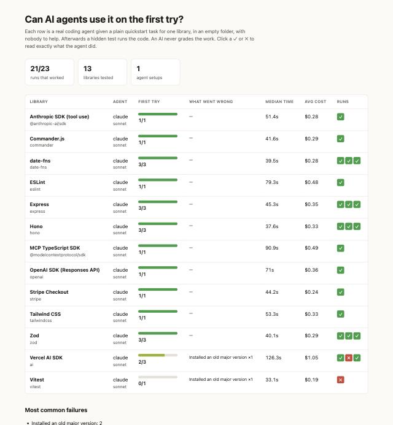

# OneShot

**Your AI coding agent writes last year's versions from memory. OneShot gives it today's, so it gets it right in one shot.**

Agents write model names, GitHub Actions versions, Docker images and runtime versions from memory, and those go stale fast. We measured it with Claude Code (Sonnet), 15 runs per setup, each run checked by a real test:

| Setup | Wrote current values | Median time per run | Median cost per run |
|---|---|---|---|
| Nothing | 2 of 15 | 42 s | $0.25 |
| "Always use the newest versions" in CLAUDE.md | 13 of 15 | 68 s | $0.43 |
| **OneShot** | **15 of 15** | **41 s** | **$0.27** |

Without help, agents wrote `claude-opus-4-8`, `actions/checkout@v4` and `node:24`. Told to "use the newest", they searched the web: right most of the time, but 64% slower and 72% more expensive. With OneShot they asked once and were right every time. All runs and transcripts are in `results/live-v1/`.

## Use it in your project

```bash
npx oneshot-agent init        # MCP tools + a Claude Code Stop hook + one line in CLAUDE.md
```

Not on npm yet? Run it from GitHub: `npx github:borossdaniel/OneShot facts`

| Command | What it does |
|---|---|
| `oneshot-agent facts` | Today's newest AI model names, GitHub Actions versions, Node.js/Python LTS and matching Docker images |
| `oneshot-agent check <pkg>` | Current version of any npm or PyPI package, the install command, and known agent mistakes |
| `oneshot-agent check` | Scans the project: outdated dependencies, old model names in code, old Actions in workflows, old base images in Dockerfiles. Exits 1, so it works in CI |
| `oneshot-agent mcp` | MCP server with `current_facts`, `check_package` and `check_project`, for Claude Code, Cursor and others |
| `oneshot-agent hook` | Claude Code Stop hook: if anything is outdated, the agent fixes it before it can say "done" |

Claude Code only:
```bash
claude mcp add oneshot -- npx -y oneshot-agent mcp
```

No account and no tracking. Sources: npm, PyPI, deps.dev, endoflife.date, GitHub releases, and a curated model list in `data/models.json`.

### Package versions: a one-line fix is enough

For npm packages, `@latest` already knows the answer, so one line in CLAUDE.md fixes it. Across 31 libraries, agents installed an outdated major in about 1 in 5 runs; with an "install the latest" line it was 0 of 30 (`results/ab-oneline/`). OneShot still checks packages, but the live facts above are where it matters.

## The benchmark: can an agent use your library on the first try?

More and more developers never read your quickstart. They type "add Zod validation" or "set up the AI SDK" into Claude Code, Codex or Gemini CLI and accept what comes back. When the agent installs last year's major version, invents an API, or gives up, the developer doesn't file a bug. They pick a different library.

OneShot measures that moment:

1. It creates an **empty folder** and gives a real agent the prompt a developer would type.
2. The agent works **unattended**. Nobody answers questions and nothing hangs on a permission prompt.
3. A **hidden test** then runs the code. An AI never grades the work.
4. You get a score ("4/5 first tries"), the failure type, time and cost, the full transcript, the files the agent wrote, and a README badge.

```
▶ ai-sdk · claude/sonnet · trial 1
  ✅ pass — ai@7.0.183: multi-step tool call and structured output correct (249.6s, $1.744)
▶ ai-sdk · claude/sonnet · trial 2
  ❌ outdated_major — ai@5.0.294 installed, current major is 7 (126.3s, $0.628)
▶ zod · claude/sonnet · trial 1
  ✅ pass — zod@4.6.7: schema, defaults and error messages correct (52s, $0.429)
```



**First real runs, 26 Nov 2026:** Claude Code with Sonnet, 23 runs across 13 libraries. The runs are in `results/`.

- **21 of 23 worked.** That includes libraries whose current major version came out after the model's training data: OpenAI SDK 7, Anthropic SDK 1.x, Stripe 23, Commander 15, ESLint 10 and Tailwind 4.
- **Both failures were the same quiet mistake.** The agent wrote an old version into `package.json` from memory: `"ai": "^5.0.0"` when v7 is current, and `"vitest": "^2.1.9"` when v5 is current. It then tested against that old version and reported success, without mentioning the version.
- **Some libraries cost much more agent effort.** Vercel AI SDK runs had a median of 126 seconds and about $1.05 a run (one took 51 turns). Most libraries were around 40 seconds and $0.30.

These are small samples, so read them as hints, not rankings.

## Quick start

```bash
git clone https://github.com/borossdaniel/OneShot.git && cd OneShot
npm test                     # pipeline tests, no AI needed
npm run verify-tasks         # proves each check passes good code and fails bad code
node bin/oneshot.js run tasks --agent claude --model sonnet --trials 3
node bin/oneshot.js report results --out site && open site/index.html
```

It needs Node 20 or newer and a logged-in agent CLI (`claude`, `codex` or `gemini`). There are no npm dependencies.

## What counts as a failure

| Category | Meaning |
|---|---|
| `outdated_major` | The agent installed an old major version (for example Express 4 or Zod 3) |
| `not_installed` | The library never got installed, often because of a made-up package name |
| `crash` | The code throws when loaded or called |
| `wrong_behavior` | It runs but does the wrong thing, for example a 404 that is plain text instead of JSON |
| `no_solution` | The file we asked for was never written |
| `agent_timeout` / `agent_error` | The agent run itself died. It counts against the run, not the library |

## Tasks (13)

| Task | What it tests | Typical trap |
|---|---|---|
| `zod` | Schema, defaults, per-field error messages | v3 vs v4 APIs (`z.string().email()` vs `z.email()`, `flatten()` vs `z.flattenError`) |
| `date-fns` | Business days, strict distance, ISO week labels | `yyyy` vs `RRRR` ISO week-year |
| `hono` | Routes, middleware, JSON 404 | Default 404 is plain text |
| `express` | Wildcard route, async errors | Express 5 wildcard syntax (`/*name`) and async error handling |
| `ai-sdk` | Multi-step tool call, structured output | `maxSteps` and `parameters` from v4 vs `stopWhen` and `inputSchema` |
| `openai` | Responses API text and structured output (v7, July 2026) | Chat Completions instead of Responses; no `json_schema` format |
| `anthropic` | Full tool-use loop (SDK 1.x, Oct 2026) | Tool result sent as plain text instead of a `tool_result` block |
| `stripe` | Subscription Checkout Session (v23, Oct 2026) | Missing `{CHECKOUT_SESSION_ID}` in the success URL |
| `mcp` | MCP server: tool with Zod validation and a resource | Deprecated `server.tool()`; non-text tool results |
| `commander` | Subcommand, options, built-in validation (v15, May 2026) | Hand-rolled validation instead of `InvalidArgumentError` |
| `tailwind` | Static-site build with a custom colour | Tailwind 3 setup (`tailwind.config.js`, `@tailwind` directives) |
| `eslint` | Flat config, rules, Node globals (v10) | Legacy `.eslintrc`, missing `globals.node` |
| `vitest` | Tests that run once and catch broken code (v5) | Watch mode; tests that miss edge cases |

API tasks (OpenAI, Anthropic, Stripe) run against a local fake server, so they need no keys and spend no money. The check also verifies exactly what the code sent.

Each task ships with `reference/good` and `reference/bad-*` solutions. `npm run verify-tasks` runs them through the real check, so you can see the test is fair before trusting a score.

## Add your own library

A task is a folder:

```
my-lib/
  task.json     { "id", "name", "package", "currentMajor", "prompt", "timeoutSec" }
  check.mjs     a real test that runs after the agent finishes
  reference/    optional: good/ and bad-<category>/ solutions
```

```js
// check.mjs
import { runCheck, expectInstalled, importSolution, expectEqual } from 'oneshot-agent/check';

runCheck(async (ws) => {
  expectInstalled(ws, 'my-lib', 3);          // installed, and at least v3
  const m = await importSolution(ws);        // the agent's solution.mjs
  expectEqual(await m.doThing(2), 4, 'doThing(2)');
});
```

Then run `npx oneshot-agent run ./my-lib --agent claude --trials 5` and add the badge from `site/badges/my-lib.svg`.

## How runs are kept fair

- **Same starting point:** every run gets a fresh, empty temporary folder.
- **No local helpers:** Claude Code runs with `--setting-sources project --strict-mcp-config`, so your own plugins, hooks and MCP servers don't help or hurt the agent.
- **No hanging:** the agent can use a fixed allow-list of tools (file edits, npm, node, web fetch/search). Everything else is denied rather than left waiting for approval.
- **Limits:** each run has a time limit (`timeoutSec`) and, for Claude, a spending cap (`--max-budget-usd`, default $2).
- **Auditable:** everything is published (prompt, transcript, the agent's files, the check), so anyone can rerun and dispute a score.
- **No grading by AI:** the score comes from a test that executes the code.

## Status

- **Version:** 0.1, an MVP.
- **Agents:** the Claude Code adapter has been tested. The Codex and Gemini adapters are written but not yet run.
- **Tasks:** 13 (5 starter, 8 harder).
- **Next:** more tasks, Python support, a GitHub Action that re-runs on every docs change, and a hosted leaderboard.

MIT licensed.

## Limits

- It checks versions and known traps. It does not review your logic or find bugs.
- It needs internet to ask npm and PyPI for the latest version. Offline, it stays quiet and never blocks your agent.
- Hand-written notes exist for the libraries on the board. Other packages get the current version plus release-date and deprecation warnings.
- 0.x packages and calendar-versioned packages (certifi 2026.x) are not flagged as outdated.
- If you pin an old major on purpose, the check only warns.
- The board uses one agent (Claude Code with Sonnet), 5 runs per library. Small samples, published in full.
